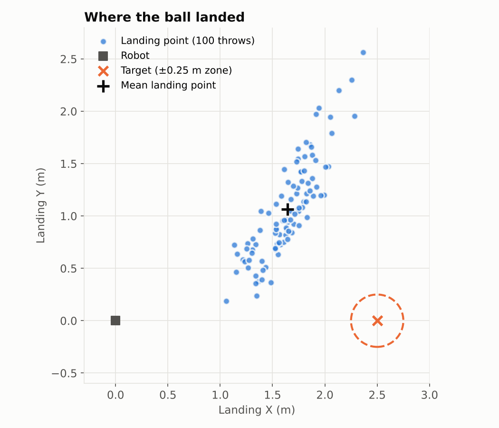
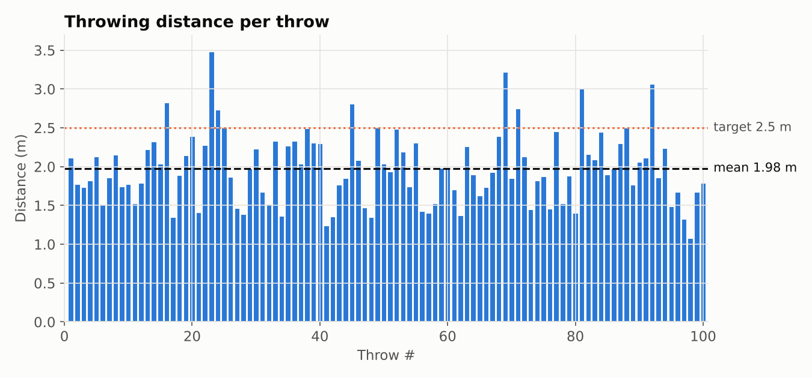
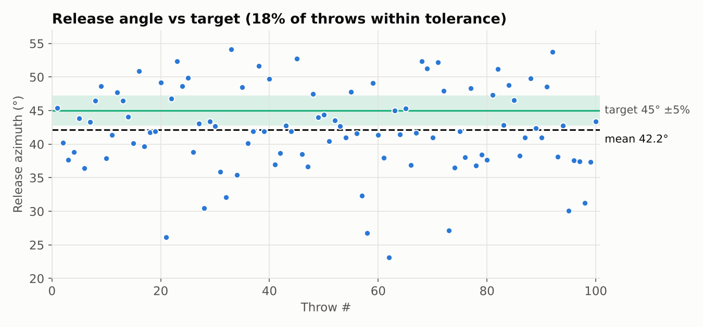
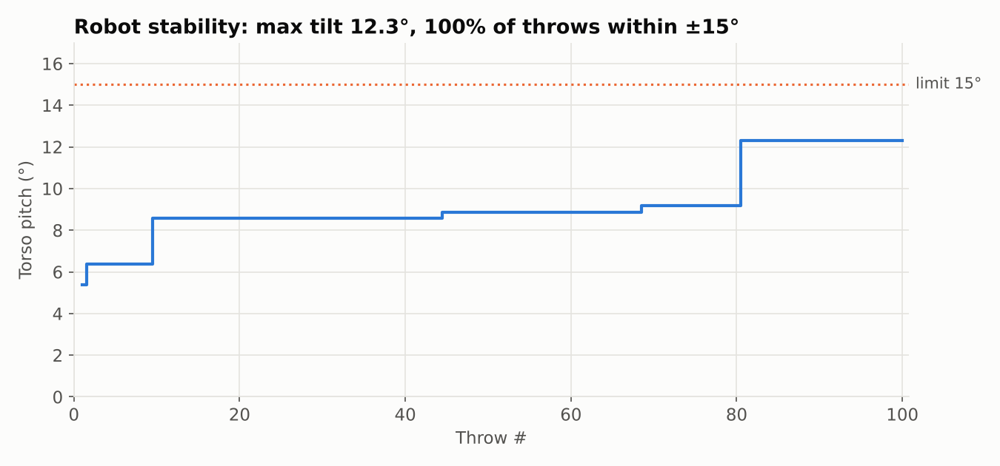

# ADC Team 02 — Ball Throw with Reinforcement Learning


Built in just one week for the 2026 Audi AI & Robotics challenge, this project demonstrates how we bridged the gap between deterministic whole-body control and reinforcement learning on a free-floating robotic base.

A simulated Unitree G1 (29 DoF) humanoid learns to throw a ball directly in
front of itself using Reinforcement Learning (PPO) in MuJoCo.

## Project structure

```
assets/unitree_g1/  official Unitree G1 29DoF MuJoCo model (from unitree_mujoco)
envs/               Gymnasium environment (adapted from course throw env)
scripts/            scene creation, training, evaluation, playback scripts
                    (adapted from humanoid-robot-fundamentals course repo)
src/                commented reference skeletons (learning material)
models/             (unused — kept for extra scene files)
results/            evaluation graphs, logs, landing-position data
trained_models/     saved policies
docs/               Task 1 task definition, Task 3 Sim2Real concept
```

Credits: G1 model from https://github.com/unitreerobotics/unitree_mujoco;
pipeline scripts adapted from the course repo by Rudolf Krecht.

## Setup

```
python -m venv .venv
.venv\Scripts\activate        # Windows  (Linux/Mac: source .venv/bin/activate)
pip install -r requirements.txt
```

## How to run

```
python src/baseline.py        # run scripted baseline
python src/train.py           # train the RL policy
python src/evaluate.py        # evaluate policy + produce graphs
```

## Team

- Benjamin Collu
- Khansa Rajid
- Andrej Krizan
- Daniel Sirghii
- Assyl Mursalim
- Natalia Stranovska

## My contribution (Khansa Rajid)

I worked on the scripted baseline, the reinforcement learning training and the evaluation:

- **Scripted baseline (Task 1):** built the deterministic throwing motion for the Unitree G1 in MuJoCo, which set the reference performance the RL policy had to beat.
- **RL training (Task 2):** ran and iterated on the PPO training runs (Gymnasium + Stable-Baselines3), training the policy to throw the ball forward from a free-floating base.
- **Evaluation:** evaluated the trained policies against the baseline and produced the evaluation graphs.

## Results (trained RL policy, 100 throws)

The trained PPO policy was evaluated over 100 throws in MuJoCo. Full data: [results/throw_results.csv](results/throw_results.csv)

| Metric | Result |
|---|---|
| Throwing distance | 1.98 m mean (max 3.49 m) |
| Release velocity | 5.42 m/s mean |
| Release time | 0.116 s mean |
| Stability | 100% of throws within ±15° torso tilt (max 12.3°) |
| Release angle | 42.2° mean vs 45° target, 18% within tolerance |
| Target error | 1.44 m mean, 0% inside the 0.25 m target zone |
| Repeatability | 0.54 m landing spread |

**Takeaway:** the policy throws reliably and keeps the robot balanced, and its landings cluster tightly. The cluster sits about 1 m to the side of the target, so the miss is mainly in aim direction rather than power. Release-angle control is the next thing to improve.









*Torso tilt is recorded as the running maximum across throws; it never exceeded 12.3°.*

## Task overview

1. **Task 1** — task definition, success criteria, validated sim, scripted baseline
2. **Task 2** — RL pipeline (Gymnasium + Stable-Baselines3 PPO), training, evaluation graphs
3. **Task 3** — Sim2Real gap analysis, robustness concept, limitations, final presentation
